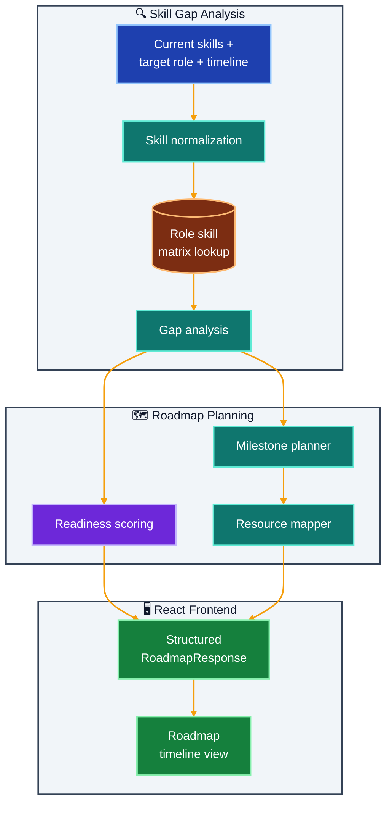

# SkillPath AI

Personalized developer roadmap generator starter with skills-gap planning flow.

## What It Does

- Maps a target role to expected skill requirements
- Normalizes and evaluates current skills
- Calculates skill gaps and readiness score
- Produces weekly milestones with outcomes and resource suggestions

## Implemented Feature Slice (Project 08)

- Skills-gap analysis against target role skill matrix
- Readiness scoring out of 100
- Milestone generation over configurable weeks
- Resource suggestions mapped to each skill gap
- Structured request/response schemas for robust API usage

## Architecture



## Outcome

- Gives learners a role-specific, actionable upskilling plan
- Highlights exact missing competencies instead of generic advice
- Improves planning clarity with measurable readiness scoring

## Quick Start

### Prerequisites

- [UV](https://docs.astral.sh/uv/) installed
- [Node.js 20+](https://nodejs.org/)

### 1. Backend

```bash
cd skillpath-ai/backend
uv sync

cp .env.example .env   # all values have sensible defaults

uv run uvicorn app.main:app --reload --port 8000
```

### 2. Frontend

```bash
cd skillpath-ai/frontend
npm install
npm run dev
# → http://localhost:5173
```

### 3. Docker Compose (optional)

```bash
docker-compose up --build
```

---

## Environment Variables

| Variable | Default | Description |
|---|---|---|
| `FRONTEND_ORIGIN` | `http://localhost:5173` | CORS allowed origin for the React frontend |
| `LOG_LEVEL` | `INFO` | Python logging verbosity (`DEBUG` \| `INFO` \| `WARNING` \| `ERROR`) |

---

## Project Structure

```
skillpath-ai/
├── backend/
│   ├── app/
│   │   ├── api/routes.py            # POST /api/roadmap, GET /api/health
│   │   ├── core/config.py           # Pydantic Settings — CORS, log level
│   │   ├── models/schemas.py        # RoadmapRequest, RoadmapResponse, RoadmapMilestone
│   │   ├── services/roadmap.py      # Role matrix, gap analysis, milestone planner, resource mapper
│   │   └── main.py
│   ├── pyproject.toml
│   └── .env.example
├── frontend/
│   ├── src/
│   │   ├── App.jsx                  # Role/skills/weeks form + roadmap timeline display
│   │   └── lib/api.js               # fetchRoadmap() typed API call
│   └── package.json
├── docker-compose.yml
└── README.md
```

---

## API Reference

### `POST /api/roadmap`

**Request:**

```json
{
  "current_skills": ["python", "sql", "pandas", "scikit-learn"],
  "target_role": "AI Engineer",
  "weeks": 8
}
```

**Response:**

```json
{
  "target_role": "AI Engineer",
  "current_skills": ["python", "sql", "pandas", "scikit-learn"],
  "gap_skills": ["langchain", "vector databases", "fastapi", "prompt engineering"],
  "readiness_score": 42,
  "milestones": [
    {
      "week": 2,
      "focus": "LangChain and prompt engineering",
      "outcomes": ["Build a basic RAG pipeline", "Understand chain types"],
      "resources": ["LangChain docs", "Prompt Engineering Guide"]
    }
  ]
}
```

### `GET /api/health`

```json
{ "status": "ok" }
```

---

## Logging

- Python logging is configured in app startup and controlled by LOG_LEVEL.
- Frontend API logging is controlled by VITE_LOG_LEVEL.
